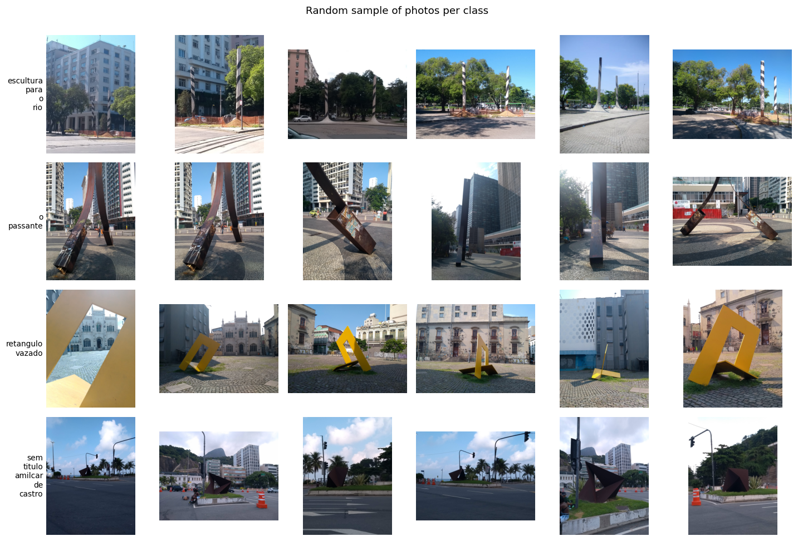
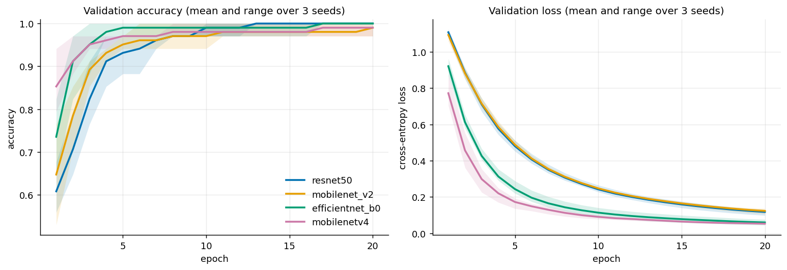
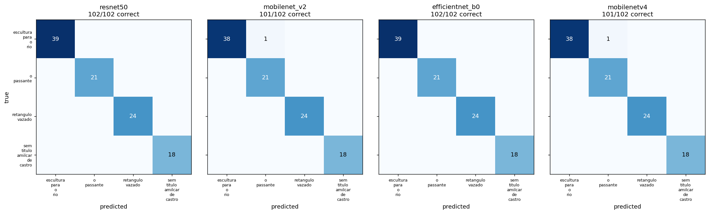
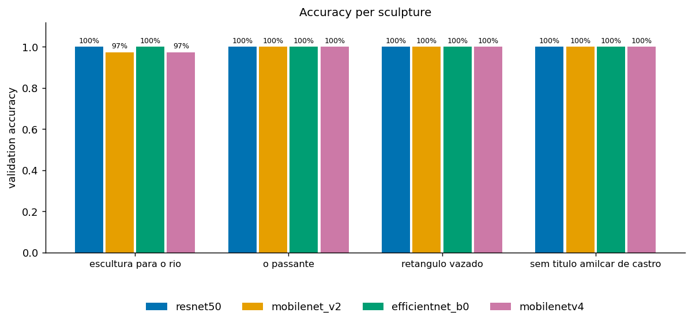
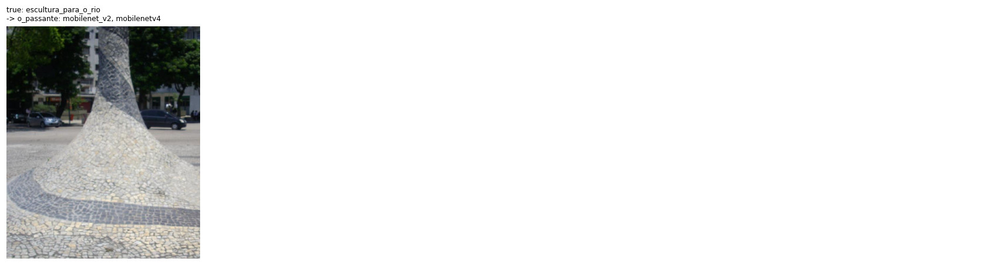

# Reconhecimento de esculturas públicas com redes convolucionais pré-treinadas: comparação de quatro arquiteturas

*Autor: [a preencher]* · *Experimento executado em 16 de novembro de 2026* · [English version](report.md)

## Resumo

Investigamos se fotografias de esculturas públicas do Rio de Janeiro podem ser reconhecidas
por transferência de aprendizado a partir do ImageNet e se a escolha da rede pré-treinada faz
diferença. Quatro redes foram comparadas (ResNet-50, MobileNetV2, EfficientNet-B0 e MobileNetV4
conv-medium) em 170 fotografias de quatro esculturas. Em todos os casos, a rede pré-treinada
foi congelada e apenas uma nova camada linear de classificação foi treinada, por 20 épocas, em
três divisões aleatórias estratificadas entre treino e validação. As quatro redes atingiram
97,1–100% de acurácia de validação em todas as execuções; nas 12 execuções, 406 de 408
predições de validação foram corretas, e os dois erros ocorreram na mesma fotografia. Portanto,
as redes não podem ser ordenadas por acurácia com estes dados. Elas diferem em tamanho por um
fator de dez (2,2 a 23,5 milhões de parâmetros). O protocolo de validação é otimista, pois
fotografias quase idênticas aparecem nos dois lados da divisão; os valores são um limite
superior, e não uma estimativa do desempenho em fotografias novas.

## 1. Introdução

Esculturas públicas são objetos fixos e visualmente característicos, fotografados de muitos
ângulos e sob iluminação variável. Reconhecer qual obra aparece em uma fotografia é uma tarefa
de reconhecimento de instâncias: as classes são objetos individuais, e não categorias. Um
sistema capaz disso poderia apoiar um aplicativo de guia em que o visitante aponta o celular
para uma obra e recebe informações sobre ela.

Coletar milhares de fotografias rotuladas por escultura é inviável, de modo que treinar uma
rede do zero não é uma opção. A transferência de aprendizado contorna o problema: uma rede
pré-treinada em um grande conjunto genérico como o ImageNet [5] já calcula características
visuais que se transferem para outras tarefas [6], e apenas uma pequena parte específica
precisa ser treinada.

Este relatório responde a duas perguntas:

1. Uma rede pré-treinada no ImageNet, congelada e com um novo classificador linear, consegue
   reconhecer estas esculturas a partir de um conjunto pequeno de fotografias?
2. A escolha da rede pré-treinada afeta o resultado, e qual rede é a mais adequada quando o
   destino é um dispositivo móvel?

## 2. Conjunto de dados

O conjunto de dados contém 170 fotografias de quatro esculturas (Tabela 1, Figura 1).

**Tabela 1.** Classes e número de fotografias. As atribuições de autoria, exceto a de Amilcar
de Castro, vêm de conhecimento geral e **devem ser confirmadas pelo autor**; uma placa
fotografada junto à obra de Amilcar de Castro traz o título "A Estrela".

| Classe (nome da pasta) | Obra | Artista | Fotografias |
| --- | --- | --- | --- |
| `escultura_para_o_rio` | *Escultura para o Rio* | Waltércio Caldas (a confirmar) | 64 |
| `o_passante` | *O Passante* | José Resende (a confirmar) | 37 |
| `retangulo_vazado` | *Retângulo Vazado* | Franz Weissmann (a confirmar) | 38 |
| `sem_titulo_amilcar_de_castro` | Sem título / "A Estrela" | Amilcar de Castro | 31 |
| **Total** | | | **170** |

**Figura 1.** Amostra aleatória de fotografias de cada classe.

**Origem.** As fotografias vêm de uma única pasta compartilhada e de seis sessões de captura
(Tabela 2).

**Tabela 2.** Fotografias por origem.

| Origem | Fotografias | Classes |
| --- | --- | --- |
| Câmera de celular, 23 de abril de 2019 | 94 | `o_passante` (36), `retangulo_vazado` (30), `sem_titulo_amilcar_de_castro` (28) |
| Imagens de aplicativo de mensagens, 20 de maio de 2019 | 46 | `escultura_para_o_rio` |
| Capturas de tela, 14 de novembro de 2019 | 12 | `escultura_para_o_rio` (6), `retangulo_vazado` (4), `sem_titulo_amilcar_de_castro` (2) |
| Imagens de aplicativo de mensagens, 14 de novembro de 2019 | 10 | `escultura_para_o_rio` |
| Imagens de referência com nome | 5 | as quatro |
| Imagens de aplicativo de mensagens, 6 de maio de 2022 | 3 | `retangulo_vazado` |

**Rotulagem.** A pasta de origem não estava rotulada. Os rótulos foram atribuídos por inspeção
visual de todas as imagens, com apoio do horário de captura (fotografias consecutivas mostram
a mesma obra) e de quatro imagens de referência cujos nomes de arquivo trazem o título da obra.

**Exclusões.** Dos 199 arquivos da pasta de origem, 10 duplicatas exatas foram removidas e 19
arquivos foram separados como inadequados para o treino: recortes de jornal, dois documentos
PDF, fotografias de placas, fotografias em que nenhuma escultura é visível, uma colagem e
artes de capa.

## 3. Método

**Redes.** Foram comparadas quatro redes convolucionais pré-treinadas no ImageNet-1k (Tabela 3).

**Tabela 3.** Redes comparadas. A contagem de parâmetros exclui a camada original de 1000 classes.

| Rede | Ano | Origem e pesos | Parâmetros | Dimensão das características |
| --- | --- | --- | --- | --- |
| ResNet-50 [1] | 2016 | torchvision, `IMAGENET1K_V2` | 23,5 M | 2048 |
| MobileNetV2 [2] | 2018 | torchvision, `IMAGENET1K_V2` | 2,2 M | 1280 |
| EfficientNet-B0 [3] | 2019 | torchvision, `IMAGENET1K_V1` | 4,0 M | 1280 |
| MobileNetV4 conv-medium [4] | 2024 | timm, `mobilenetv4_conv_medium.e500_r256_in1k` | 8,4 M | 1280 |

**Transferência de aprendizado.** Em cada rede, todos os pesos pré-treinados foram congelados
e a camada final do ImageNet foi substituída por uma nova camada linear com quatro saídas.
Apenas essa camada foi treinada: 8.196 pesos na ResNet-50 e 5.124 nas outras três. A rede
congelada foi mantida em modo de avaliação, de modo que as estatísticas de normalização em
lote não foram atualizadas.

**Pré-processamento.** As imagens foram giradas conforme a orientação EXIF e reduzidas a no
máximo 512 pixels no lado maior. As imagens de treino receberam um recorte aleatório
redimensionado para 224 × 224 pixels (escala 0,7–1,0) e espelhamento horizontal aleatório. As
imagens de validação foram redimensionadas para 256 pixels no lado menor e recortadas no
centro em 224 × 224. Todas foram normalizadas com a média e o desvio padrão do ImageNet. A
mesma entrada de 224 pixels foi usada em todas as redes, inclusive na MobileNetV4, que foi
pré-treinada em 256 pixels.

**Treinamento.** Otimizador Adam, taxa de aprendizado 0,001, lotes de 32, perda de entropia
cruzada, 20 épocas, sem agendamento de taxa de aprendizado e sem parada antecipada.

**Avaliação.** Uma divisão aleatória estratificada reservou 20% de cada classe para validação,
resultando em 136 fotografias de treino e 34 de validação. O experimento foi repetido com três
sementes aleatórias (0, 1, 2), cada uma gerando uma divisão diferente; para uma mesma semente,
todas as redes foram treinadas e avaliadas na mesma divisão. A medida reportada é a acurácia
de validação após a última época. Com 34 fotografias de validação, uma fotografia corresponde
a 2,9 pontos percentuais.

**Ambiente.** Google Colab, GPU NVIDIA Tesla T4, Python 3.13.16, PyTorch 2.14.1,
torchvision 0.29.1, timm 1.0.31. O tempo de inferência foi medido na mesma GPU para uma única
imagem de 224 × 224 (lote de tamanho 1, média de 30 passagens após aquecimento).

**Reprodutibilidade.** O procedimento completo está em `notebooks/artepublica_colab.ipynb`. A
saída bruta da execução aqui relatada está em [`results/results.json`](results/results.json).

## 4. Resultados

### 4.1 Acurácia, tamanho e velocidade

**Tabela 4.** Resumo das três sementes. A acurácia é a de validação após a época 20.

| Rede | Acurácia, média (mín–máx) | Corretas / total | Parâmetros | Arquivo de pesos | Tempo de treino por execução | Inferência por imagem |
| --- | --- | --- | --- | --- | --- | --- |
| ResNet-50 | 100% (100–100) | 102 / 102 | 23,5 M | 94,4 MB | 23,1 s | 6,1 ms |
| MobileNetV2 | 99,0% (97,1–100) | 101 / 102 | 2,2 M | 9,2 MB | 18,3 s | 5,2 ms |
| EfficientNet-B0 | 100% (100–100) | 102 / 102 | 4,0 M | 16,4 MB | 18,9 s | 8,3 ms |
| MobileNetV4 conv-medium | 99,0% (97,1–100) | 101 / 102 | 8,4 M | 34,2 MB | 18,3 s | 9,6 ms |

**Tabela 5.** Acurácia de validação após a época 20, por semente.

| Rede | Semente 0 | Semente 1 | Semente 2 |
| --- | --- | --- | --- |
| ResNet-50 | 100% | 100% | 100% |
| MobileNetV2 | 100% | 97,1% | 100% |
| EfficientNet-B0 | 100% | 100% | 100% |
| MobileNetV4 conv-medium | 100% | 97,1% | 100% |

As quatro redes classificaram corretamente todas as fotografias de validação nas sementes 0 e
2. Na semente 1, a MobileNetV2 e a MobileNetV4 cometeram um erro cada. A diferença entre a
melhor e a pior rede é de uma fotografia em 102. As 12 execuções de treino levaram 236
segundos no total.

### 4.2 Curvas de aprendizado

**Figura 2.** Acurácia de validação (esquerda) e perda de validação (direita) por época. As
linhas são a média das três sementes; as faixas vão da menor à maior semente. (Os rótulos da
figura estão em inglês, como gerados pelo notebook.)

As redes diferem na rapidez de convergência (Tabela 6). Após uma época, a acurácia média de
validação era de 85,3% na MobileNetV4 e 73,5% na EfficientNet-B0, contra 64,7% na MobileNetV2
e 60,8% na ResNet-50. A acurácia média de validação permaneceu em 97% ou mais a partir da
época 4 na EfficientNet-B0, da época 5 na MobileNetV4 e da época 8 na ResNet-50 e na
MobileNetV2.

Após 20 épocas, a perda de validação da EfficientNet-B0 (0,060) e da MobileNetV4 (0,053) era
cerca de metade da perda da ResNet-50 (0,118) e da MobileNetV2 (0,123). A perda de validação
ainda diminuía em todas as redes na época 20.

**Tabela 6.** Convergência, médias das três sementes.

| Rede | Acurácia após a época 1 | Acurácia após a época 5 | Primeira época a partir da qual a acurácia se mantém ≥ 97% | Perda de validação após a época 20 |
| --- | --- | --- | --- | --- |
| ResNet-50 | 60,8% | 93,1% | 8 | 0,118 |
| MobileNetV2 | 64,7% | 95,1% | 8 | 0,123 |
| EfficientNet-B0 | 73,5% | 99,0% | 4 | 0,060 |
| MobileNetV4 conv-medium | 85,3% | 97,1% | 5 | 0,053 |

### 4.3 Erros por classe

**Figura 3.** Matrizes de confusão, somadas nas três sementes (102 predições por rede). As
linhas são a classe verdadeira e as colunas, a classe predita.

**Figura 4.** Acurácia de validação por classe, somada nas três sementes.

Três classes (`o_passante`, `retangulo_vazado`, `sem_titulo_amilcar_de_castro`) foram
classificadas sem erro por todas as redes em todas as execuções. Os únicos erros ocorreram em
`escultura_para_o_rio`: 38 de 39 corretas (97,4%) na MobileNetV2 e na MobileNetV4.

### 4.4 A fotografia classificada incorretamente

**Figura 5.** A única fotografia de validação classificada incorretamente em alguma execução.

Os dois erros dizem respeito à mesma imagem, um detalhe da base de *Escultura para o Rio* em
que as colunas estão cortadas e o quadro é ocupado por calçamento de pedras com desenho. Ela
esteve no conjunto de validação apenas na semente 1, na qual a MobileNetV2 e a MobileNetV4 a
atribuíram a `o_passante` com confiança de 0,55 e 0,51, respectivamente; a ResNet-50 e a
EfficientNet-B0 a classificaram corretamente.

## 5. Discussão

**A tarefa, como formulada, é resolvida pelas quatro redes.** Um classificador linear sobre
características congeladas do ImageNet separa estas quatro esculturas quase perfeitamente, com
apenas 5.124 pesos treinados e menos de 25 segundos de treino. Isso responde positivamente à
primeira pergunta, dentro dos limites expostos na Seção 6.

**A acurácia não distingue as redes.** A diferença observada, uma fotografia em 102, está
dentro do que a escolha da divisão produz por si só: o erro ocorreu apenas porque uma imagem
específica caiu no conjunto de validação na semente 1. A avaliação está saturada, e nenhuma
ordenação por acurácia se justifica.

**Por que a acurácia satura.** Dois fatores são prováveis. Primeiro, as quatro obras são muito
diferentes em cor, forma e entorno. Segundo, a maioria das fotografias foi tirada em sequência,
com segundos de intervalo e quase da mesma posição, de modo que uma divisão aleatória coloca
imagens quase idênticas tanto no treino quanto na validação. O conjunto de validação mede,
então, o reconhecimento de cenas já vistas, e não a generalização para novos pontos de vista.

**O único erro é informativo.** A imagem classificada incorretamente mostra calçamento, e não
a silhueta da escultura. As fotografias de *O Passante* foram tiradas em uma praça com
calçamento de pedras com desenho, o que sugere que os classificadores se apoiam em parte no
entorno. Trata-se de uma hipótese; ela não foi testada.

**Perda e convergência favorecem as duas redes mais novas, com ressalvas.** A EfficientNet-B0
e a MobileNetV4 convergem em menos épocas e terminam com cerca de metade da perda de
validação, ou seja, atribuem probabilidade maior à classe correta. Isso é compatível com
características que separam melhor as classes, e essa margem poderia importar em uma versão
mais difícil da tarefa. Não constitui evidência de acurácia superior aqui e, com três
sementes, deve ser lido como indicativo.

**O tamanho é a diferença que está estabelecida.** As redes variam por um fator de dez em
parâmetros e em tamanho do arquivo de pesos (9,2 MB a 94,4 MB). Para um aplicativo móvel, este
é o critério relevante diante de acurácias iguais: a MobileNetV2 é a menor; a EfficientNet-B0
tem menos do dobro do seu tamanho e não cometeu erros neste experimento.

**Os tempos de inferência não devem ser transpostos para celulares.** Na Tesla T4, as quatro
redes classificam uma imagem em 5–10 ms, e a maior rede não é a mais lenta. Com lote de
tamanho 1 em GPU, o tempo é dominado pelo custo fixo por camada, e não pela quantidade de
cálculo, de modo que esses números não predizem a ordem em um processador móvel.

## 6. Limitações

- **Vazamento entre treino e validação.** A divisão aleatória não mantém juntas as fotografias
  de uma mesma sequência. A acurácia reportada é um limite superior.
- **Sem conjunto de teste independente.** Não há fotografias de outro dia, estação, horário ou
  fotógrafo para medir a generalização.
- **A classe se confunde com a sessão de captura.** Quase todas as fotografias de *O Passante*,
  *Retângulo Vazado* e da obra de Amilcar de Castro vêm de um único dia e de um único celular,
  enquanto *Escultura para o Rio* vem de outras sessões e aparelhos (Tabela 2). Um
  classificador poderia separar essa classe, em parte, por características da câmera ou do tempo.
- **Conjuntos de validação pequenos.** Com 34 fotografias por divisão, e de 6 a 13 por classe,
  diferenças de uma ou duas fotografias não se distinguem do acaso.
- **Quatro classes, conjunto fechado.** O classificador sempre responde com uma das quatro
  esculturas. Ele não tem como dizer que uma fotografia não mostra nenhuma delas, o que uma
  aplicação real exige.
- **Apenas rede congelada.** O ajuste fino da rede não foi testado.
- **Um único conjunto de hiperparâmetros.** Taxa de aprendizado, tamanho de lote e aumento de
  dados não foram ajustados, e a perda de validação ainda caía na época 20.
- **Rótulos por inspeção visual.** Os rótulos foram atribuídos em uma única passagem de
  inspeção e não foram verificados de forma independente.

## 7. Conclusão e trabalhos futuros

Uma rede pré-treinada no ImageNet, congelada e com uma nova camada linear, reconhece as quatro
esculturas deste conjunto com 99–100% de acurácia de validação, qualquer que seja a rede
usada entre as quatro. Com esta evidência, a escolha da rede deve ser feita pelo tamanho e
pelo destino de uso, e não pela acurácia: as redes voltadas a dispositivos móveis igualam a
ResNet-50 com entre um décimo e um terço do seu tamanho. A EfficientNet-B0 e a MobileNetV4,
além disso, convergem mais rápido e com perda menor.

O resultado principal é também uma afirmação sobre a avaliação: ela é fácil demais para
separar as redes ou para prever o comportamento em fotografias novas. Os próximos passos
decorrem disso:

1. **Montar um conjunto de teste independente**, com fotografias tiradas em outros dias,
   horários e ângulos, nunca usadas no treino.
2. **Dividir por sessão de captura**, e não ao acaso, para que fotografias quase idênticas
   fiquem do mesmo lado.
3. **Acrescentar esculturas**, em especial obras parecidas entre si (por exemplo, várias peças
   em aço patinável), para que a tarefa distinga as redes.
4. **Acrescentar uma classe "desconhecida"** ou um limiar de confiança para fotografias que
   não mostram nenhuma das obras conhecidas.
5. **Testar a dependência do fundo**, por exemplo com fotografias do entorno sem a escultura.
6. **Testar o ajuste fino** da rede quando houver mais dados, e características
   autossupervisionadas voltadas ao reconhecimento de instâncias.
7. **Medir a latência em um celular**, após exportar os modelos para um formato móvel.

## Referências

1. He, K., Zhang, X., Ren, S., Sun, J. (2016). Deep Residual Learning for Image Recognition. *CVPR*.
2. Sandler, M., Howard, A., Zhu, M., Zhmoginov, A., Chen, L.-C. (2018). MobileNetV2: Inverted Residuals and Linear Bottlenecks. *CVPR*.
3. Tan, M., Le, Q. V. (2019). EfficientNet: Rethinking Model Scaling for Convolutional Neural Networks. *ICML*.
4. Qin, D., et al. (2024). MobileNetV4: Universal Models for the Mobile Ecosystem. *ECCV*.
5. Deng, J., Dong, W., Socher, R., Li, L.-J., Li, K., Fei-Fei, L. (2009). ImageNet: A Large-Scale Hierarchical Image Database. *CVPR*.
6. Yosinski, J., Clune, J., Bengio, Y., Lipson, H. (2014). How Transferable Are Features in Deep Neural Networks? *NeurIPS*.
7. Paszke, A., et al. (2019). PyTorch: An Imperative Style, High-Performance Deep Learning Library. *NeurIPS*.
8. Wightman, R. (2019). PyTorch Image Models (timm). GitHub repository.
