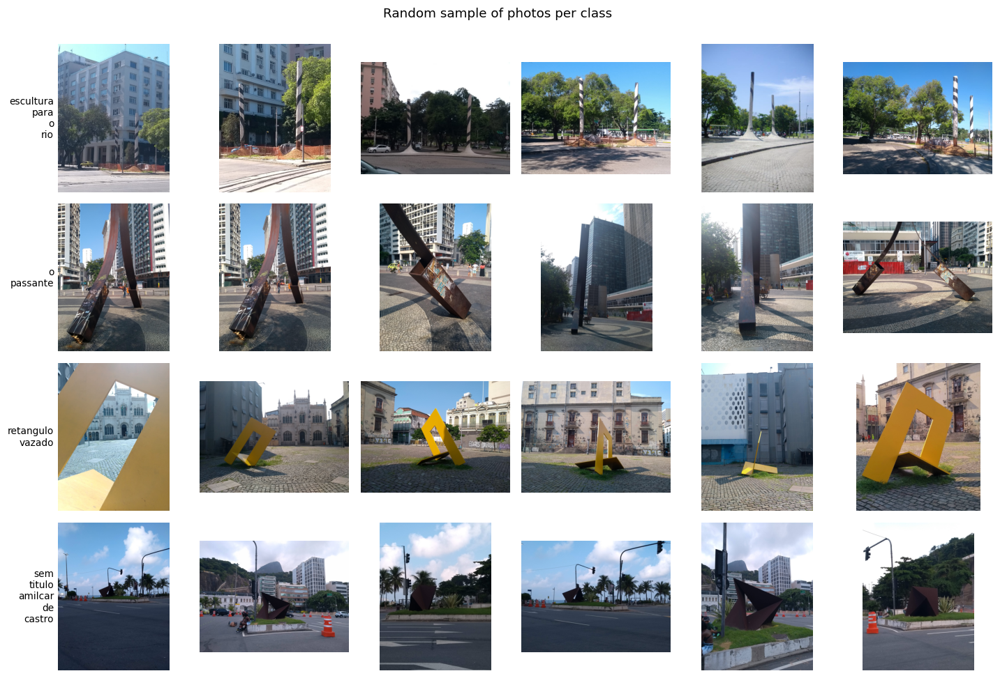
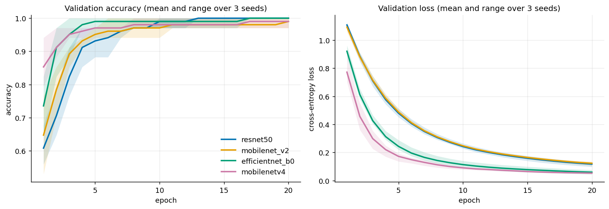
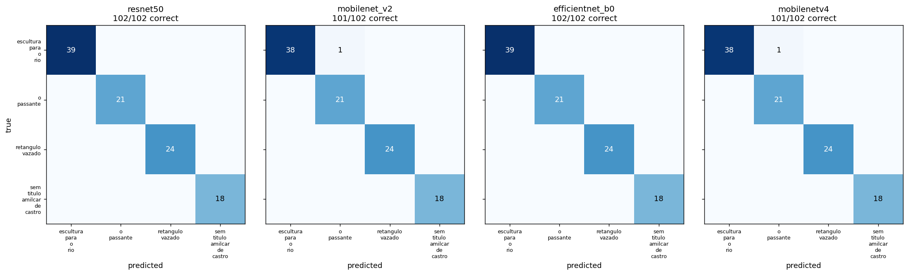
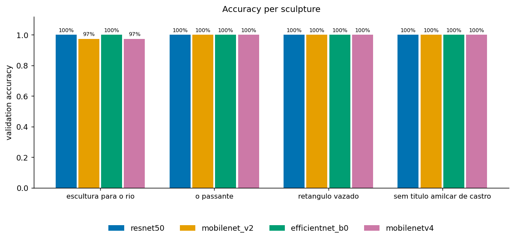
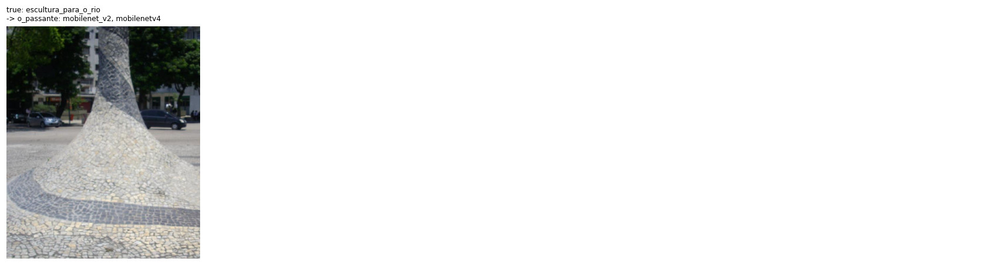

# Recognising public sculptures with pretrained convolutional networks: a comparison of four backbones

*Author: [to be filled in]* · *Experiment run on 16 November 2026* · [Versão em português](relatorio.md)

## Abstract

We study whether photographs of individual public sculptures in Rio de Janeiro can be
recognised by transfer learning from ImageNet, and whether the choice of pretrained network
matters. Four networks were compared (ResNet-50, MobileNetV2, EfficientNet-B0 and MobileNetV4
conv-medium) on 170 photographs of four sculptures. In each case the pretrained backbone was
frozen and only a new linear classification layer was trained, for 20 epochs, over three random
stratified train/validation splits. All four networks reached 97.1–100% validation accuracy in
every run; across the 12 runs, 406 of 408 validation predictions were correct, and both errors
fell on the same photograph. The networks therefore cannot be ranked on accuracy with this
data. They differ in size by a factor of ten (2.2 to 23.5 million parameters). The validation
protocol is optimistic, because near-identical photographs appear on both sides of the split,
so these figures are an upper bound and not an estimate of performance on new photographs.

## 1. Introduction

Public sculptures are fixed, visually distinctive objects, photographed from many angles and
under varying light. Recognising which work appears in a photograph is an instance-recognition
task: the classes are individual objects, not categories. A system able to do this could
support a guide application in which a visitor points a phone at a work and receives
information about it.

Collecting thousands of labelled photographs per sculpture is impractical, so training a
network from scratch is not an option. Transfer learning addresses this: a network pretrained
on a large generic dataset such as ImageNet [5] already computes visual features that transfer
to other tasks [6], and only a small task-specific part needs to be trained.

This report asks two questions:

1. Can a frozen ImageNet-pretrained network with a new linear classifier recognise these
   sculptures from a small set of photographs?
2. Does the choice of pretrained network affect the result, and which network is the most
   suitable when the target is a mobile device?

## 2. Dataset

The dataset contains 170 photographs of four sculptures (Table 1, Figure 1).

**Table 1.** Classes and number of photographs. Artist attributions other than Amilcar de
Castro are from general knowledge and are **to be confirmed by the author**; a plaque
photographed with the Amilcar de Castro work gives its title as "A Estrela".

| Class (folder name) | Work | Artist | Photographs |
| --- | --- | --- | --- |
| `escultura_para_o_rio` | *Escultura para o Rio* | Waltércio Caldas (to confirm) | 64 |
| `o_passante` | *O Passante* | José Resende (to confirm) | 37 |
| `retangulo_vazado` | *Retângulo Vazado* | Franz Weissmann (to confirm) | 38 |
| `sem_titulo_amilcar_de_castro` | Untitled / "A Estrela" | Amilcar de Castro | 31 |
| **Total** | | | **170** |

**Figure 1.** Random sample of photographs from each class.

**Sources.** The photographs come from a single shared folder and from six capture sessions
(Table 2).

**Table 2.** Photographs by source.

| Source | Photographs | Classes covered |
| --- | --- | --- |
| Phone camera, 23 April 2019 | 94 | `o_passante` (36), `retangulo_vazado` (30), `sem_titulo_amilcar_de_castro` (28) |
| Messaging-app images, 20 May 2019 | 46 | `escultura_para_o_rio` |
| Screenshots, 14 November 2019 | 12 | `escultura_para_o_rio` (6), `retangulo_vazado` (4), `sem_titulo_amilcar_de_castro` (2) |
| Messaging-app images, 14 November 2019 | 10 | `escultura_para_o_rio` |
| Named reference images | 5 | all four |
| Messaging-app images, 6 May 2022 | 3 | `retangulo_vazado` |

**Labelling.** The source folder was not labelled. Labels were assigned by visual inspection of
every image, guided by capture time (consecutive photographs show the same work) and by four
reference images whose file names carry the title of the work.

**Exclusions.** Of the 199 files in the source folder, 10 exact duplicates were removed and 19
files were set aside as unsuitable for training: newspaper clippings, two PDF documents,
photographs of plaques, photographs in which no sculpture is visible, a collage and cover
artwork.

## 3. Method

**Networks.** Four convolutional networks pretrained on ImageNet-1k were compared (Table 3).

**Table 3.** Networks compared. Parameter counts exclude the original 1000-class layer.

| Network | Year | Source and weights | Parameters | Feature size |
| --- | --- | --- | --- | --- |
| ResNet-50 [1] | 2016 | torchvision, `IMAGENET1K_V2` | 23.5 M | 2048 |
| MobileNetV2 [2] | 2018 | torchvision, `IMAGENET1K_V2` | 2.2 M | 1280 |
| EfficientNet-B0 [3] | 2019 | torchvision, `IMAGENET1K_V1` | 4.0 M | 1280 |
| MobileNetV4 conv-medium [4] | 2024 | timm, `mobilenetv4_conv_medium.e500_r256_in1k` | 8.4 M | 1280 |

**Transfer learning.** For each network, all pretrained weights were frozen and the final
ImageNet layer was replaced by a new linear layer with four outputs. Only this layer was
trained: 8,196 weights for ResNet-50 and 5,124 for the other three. The backbone was kept in
evaluation mode, so batch-normalisation statistics were not updated.

**Preprocessing.** Images were rotated according to their EXIF orientation and reduced to at
most 512 pixels on the long side. Training images received a random resized crop to 224 × 224
pixels (scale 0.7–1.0) and a random horizontal flip. Validation images were resized to 256
pixels on the short side and centre-cropped to 224 × 224. All images were normalised with the
ImageNet mean and standard deviation. The same 224-pixel input was used for all networks,
including MobileNetV4, which was pretrained at 256 pixels.

**Training.** Adam optimiser, learning rate 0.001, batch size 32, cross-entropy loss, 20
epochs, no learning-rate schedule and no early stopping.

**Evaluation.** A stratified random split kept 20% of each class for validation, giving 136
training and 34 validation photographs. The experiment was repeated with three random seeds
(0, 1, 2), each producing a different split; for a given seed all networks were trained and
evaluated on the same split. The reported score is the validation accuracy after the final
epoch. With 34 validation photographs, one photograph corresponds to 2.9 percentage points.

**Environment.** Google Colab, NVIDIA Tesla T4 GPU, Python 3.13.16, PyTorch 2.14.1,
torchvision 0.29.1, timm 1.0.31. Inference time was measured on the same GPU for a single
224 × 224 image (batch size 1, mean of 30 passes after warm-up).

**Reproducibility.** The complete procedure is in `notebooks/artepublica_colab.ipynb`. The raw
output of the run reported here is in [`results/results.json`](results/results.json).

## 4. Results

### 4.1 Accuracy, size and speed

**Table 4.** Summary over three seeds. Accuracy is validation accuracy after epoch 20.

| Network | Accuracy, mean (min–max) | Correct / total | Parameters | Checkpoint | Training time per run | Inference per image |
| --- | --- | --- | --- | --- | --- | --- |
| ResNet-50 | 100% (100–100) | 102 / 102 | 23.5 M | 94.4 MB | 23.1 s | 6.1 ms |
| MobileNetV2 | 99.0% (97.1–100) | 101 / 102 | 2.2 M | 9.2 MB | 18.3 s | 5.2 ms |
| EfficientNet-B0 | 100% (100–100) | 102 / 102 | 4.0 M | 16.4 MB | 18.9 s | 8.3 ms |
| MobileNetV4 conv-medium | 99.0% (97.1–100) | 101 / 102 | 8.4 M | 34.2 MB | 18.3 s | 9.6 ms |

**Table 5.** Validation accuracy after epoch 20, per seed.

| Network | Seed 0 | Seed 1 | Seed 2 |
| --- | --- | --- | --- |
| ResNet-50 | 100% | 100% | 100% |
| MobileNetV2 | 100% | 97.1% | 100% |
| EfficientNet-B0 | 100% | 100% | 100% |
| MobileNetV4 conv-medium | 100% | 97.1% | 100% |

All four networks classified every validation photograph correctly in seeds 0 and 2. In seed 1,
MobileNetV2 and MobileNetV4 each made one error. The difference between the best and worst
network is one photograph out of 102. The 12 training runs took 236 seconds in total.

### 4.2 Learning curves

**Figure 2.** Validation accuracy (left) and validation loss (right) per epoch. Lines are the
mean over three seeds; bands span the lowest and highest seed.

The networks differ in how quickly they converge (Table 6). After one epoch, mean validation
accuracy was 85.3% for MobileNetV4 and 73.5% for EfficientNet-B0, against 64.7% for MobileNetV2
and 60.8% for ResNet-50. Mean validation accuracy stayed at or above 97% from epoch 4 for
EfficientNet-B0, epoch 5 for MobileNetV4, and epoch 8 for ResNet-50 and MobileNetV2.

After 20 epochs, the validation loss of EfficientNet-B0 (0.060) and MobileNetV4 (0.053) was
about half that of ResNet-50 (0.118) and MobileNetV2 (0.123). Validation loss was still
decreasing for all networks at epoch 20.

**Table 6.** Convergence, means over three seeds.

| Network | Accuracy after epoch 1 | Accuracy after epoch 5 | First epoch from which accuracy stays ≥ 97% | Validation loss after epoch 20 |
| --- | --- | --- | --- | --- |
| ResNet-50 | 60.8% | 93.1% | 8 | 0.118 |
| MobileNetV2 | 64.7% | 95.1% | 8 | 0.123 |
| EfficientNet-B0 | 73.5% | 99.0% | 4 | 0.060 |
| MobileNetV4 conv-medium | 85.3% | 97.1% | 5 | 0.053 |

### 4.3 Errors by class

**Figure 3.** Confusion matrices, summed over three seeds (102 predictions per network). Rows
are the true class, columns the predicted class.

**Figure 4.** Validation accuracy per class, summed over three seeds.

Three classes (`o_passante`, `retangulo_vazado`, `sem_titulo_amilcar_de_castro`) were
classified without error by every network in every run. The only errors were on
`escultura_para_o_rio`: 38 of 39 correct (97.4%) for MobileNetV2 and for MobileNetV4.

### 4.4 The misclassified photograph

**Figure 5.** The only validation photograph misclassified in any run.

Both errors concern the same image, a close-up of the base of *Escultura para o Rio* in which
the columns are cut off and the frame is filled by patterned stone paving. It was in the
validation set only in seed 1, where MobileNetV2 and MobileNetV4 assigned it to `o_passante`
with confidence 0.55 and 0.51 respectively; ResNet-50 and EfficientNet-B0 classified it
correctly.

## 5. Discussion

**The task as posed is solved by all four networks.** A linear classifier on frozen ImageNet
features separates these four sculptures almost perfectly, with as few as 5,124 trained
weights and under 25 seconds of training. This answers the first question positively, within
the limits set out in Section 6.

**Accuracy does not discriminate between the networks.** The observed difference, one
photograph in 102, is within what the choice of split alone produces: the error occurred only
because one particular image fell in the validation set in seed 1. The evaluation is saturated,
and no ranking by accuracy is justified.

**Why accuracy saturates.** Two factors are likely. First, the four works are visually very
different in colour, shape and setting. Second, most photographs were taken in bursts, seconds
apart and from nearly the same position, so a random split places near-identical images in
both the training and the validation set. The validation set then measures recognition of
scenes already seen, not generalisation to new viewpoints.

**The single error is informative.** The misclassified image shows paving and not the
sculpture's silhouette. The photographs of *O Passante* were taken in a square with patterned
stone paving, which suggests that the classifiers rely in part on the surroundings. This is a
hypothesis; it was not tested.

**Loss and convergence favour the two newer networks, tentatively.** EfficientNet-B0 and
MobileNetV4 converge in fewer epochs and end with about half the validation loss, which means
they assign higher probability to the correct class. This is consistent with their features
separating the classes more cleanly, and such a margin could matter on a harder version of the
task. It does not amount to evidence of better accuracy here, and with three seeds it should
be read as suggestive.

**Size is the difference that is established.** The networks span a factor of ten in
parameters and checkpoint size (9.2 MB to 94.4 MB). For a mobile application this is the
relevant criterion given equal accuracy: MobileNetV2 is the smallest, EfficientNet-B0 is
under twice its size and made no errors in this experiment.

**The latency figures should not be transferred to phones.** On the Tesla T4 all four networks
classify an image in 5–10 ms, and the largest network is not the slowest. At batch size 1 on a
GPU, time is dominated by per-layer overhead and not by the amount of computation, so these
numbers do not predict the ordering on a mobile processor.

## 6. Limitations

- **Leakage between training and validation.** The random split does not keep photographs from
  the same burst together. The reported accuracy is an upper bound.
- **No held-out test set.** There are no photographs from a different day, season, time of day
  or photographer on which to measure generalisation.
- **Class is confounded with capture session.** Almost all photographs of *O Passante*,
  *Retângulo Vazado* and the Amilcar de Castro work come from one day and one phone, while *Escultura para o Rio* comes from other sessions and devices (Table 2). A
  classifier could partly separate that class by camera or weather characteristics.
- **Small validation sets.** With 34 photographs per split, and 6 to 13 per class, differences
  of one or two photographs cannot be distinguished from chance.
- **Four classes, closed set.** The classifier always answers with one of the four sculptures.
  It has no way to say that a photograph shows none of them, which a real application needs.
- **Frozen backbone only.** Fine-tuning the backbone was not tried.
- **One set of hyperparameters.** Learning rate, batch size and augmentation were not tuned,
  and validation loss was still falling at epoch 20.
- **Labels from visual inspection.** Labels were assigned by one pass of inspection and have
  not been independently checked.

## 7. Conclusion and future work

A frozen ImageNet-pretrained network with a new linear layer recognises the four sculptures in
this dataset with 99–100% validation accuracy, whichever of the four networks is used. On this
evidence the choice of network should be made on size and deployment target, not accuracy:
the mobile-oriented networks match ResNet-50 at between one tenth and one third of its size.
EfficientNet-B0 and MobileNetV4 additionally converge faster and with lower loss.

The main result is also a statement about the evaluation: it is too easy to separate the
networks or to predict behaviour on new photographs. The next steps follow from that:

1. **Build a held-out test set** of photographs taken on other days, at other times and from
   other angles, never used for training.
2. **Split by capture session** instead of at random, so that near-identical photographs stay
   on the same side.
3. **Add sculptures**, particularly works that resemble each other (for example several
   weathering-steel pieces), to make the task discriminate between networks.
4. **Add an "unknown" class** or a confidence threshold for photographs that show none of the
   known works.
5. **Test for reliance on background**, for example with photographs of the surroundings
   without the sculpture.
6. **Try fine-tuning** the backbone once more data is available, and self-supervised features
   designed for instance recognition.
7. **Measure latency on a phone** after exporting the models to a mobile format.

## References

1. He, K., Zhang, X., Ren, S., Sun, J. (2016). Deep Residual Learning for Image Recognition. *CVPR*.
2. Sandler, M., Howard, A., Zhu, M., Zhmoginov, A., Chen, L.-C. (2018). MobileNetV2: Inverted Residuals and Linear Bottlenecks. *CVPR*.
3. Tan, M., Le, Q. V. (2019). EfficientNet: Rethinking Model Scaling for Convolutional Neural Networks. *ICML*.
4. Qin, D., et al. (2024). MobileNetV4: Universal Models for the Mobile Ecosystem. *ECCV*.
5. Deng, J., Dong, W., Socher, R., Li, L.-J., Li, K., Fei-Fei, L. (2009). ImageNet: A Large-Scale Hierarchical Image Database. *CVPR*.
6. Yosinski, J., Clune, J., Bengio, Y., Lipson, H. (2014). How Transferable Are Features in Deep Neural Networks? *NeurIPS*.
7. Paszke, A., et al. (2019). PyTorch: An Imperative Style, High-Performance Deep Learning Library. *NeurIPS*.
8. Wightman, R. (2019). PyTorch Image Models (timm). GitHub repository.
